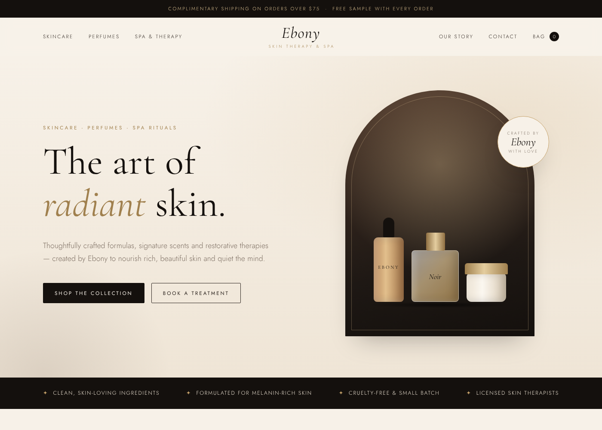

# Ebony's Skin Therapy & Spa — Online Store

An elegant storefront for **Ebony's Skin Therapy & Spa**: skincare, perfumes, and skin therapy & spa treatments.



## What's included

- **Home / hero** with the brand's ebony, cream and champagne-gold look
- **Collections**: Skincare, Perfumes, and Skin Therapy & Spa
- **Shop** with your 73-product catalog (CeraVe, The Ordinary, La Roche-Posay, Lattafa, Dior, MFK…), prices in Naira (₦), category and sub-category filters, search, sorting, "show more", and a shopping bag (saved in the browser)
- **Fragrance pick** feature (MFK Baccarat Rouge 540)
- **Spa treatments menu** with a booking request form
- **Our Story**, testimonials, newsletter sign-up, and footer
- Fully responsive (phone, tablet, desktop)

## View it

Open `index.html` in a browser. Or run a local server:

```bash
python3 -m http.server 8000
# then visit http://localhost:8000
```

To put it online for free, you can use GitHub Pages, Netlify or Vercel. No build step is needed.

## Make it yours

### Products & prices

Your product list lives in **`data/catalog.csv`**. After editing it, rebuild the shop data:

```bash
python3 tools/build_products.py
```

- The shop price is the **middle of the "Typical Nigeria price range"**, rounded to the nearest ₦500.
- To set your own exact price, add a **`Price`** column to the CSV (e.g. `25000`); it overrides the range.
- Categories map to the shop like this: Cleanser / Moisturiser / Sunscreen / Serum / Exfoliant → **Skincare**; Perfume / Body mist / Perfume oil → **Perfumes**; Body care → **Body Care**.

### Product photos

Add an **`Image`** column to `data/catalog.csv` and fill it in for each product with either:

- a **direct link to the photo** (it ends in `.jpg`, `.png` or `.webp`; on a web page, right-click the photo → *Copy image address*), or
- a **photo file** you put in the `images/` folder, e.g. `images/cerave-hydrating-cleanser.jpg`

Then run `python3 tools/build_products.py`. Photos on a white background look best. Products without a photo keep the drawn bottle, and so does any photo that fails to load. Google search links are ignored because they open a page of results, not a single photo.

### Everything else

- Spa treatments and their prices: `TREATMENTS` near the top of `script.js`
- Address, opening hours, email, social links and Ebony's story: `index.html`

## Next steps for a live shop

- **Real product photos**: replace the illustrated bottles with your own photography
- **Payments**: connect Stripe, Paystack, Flutterwave or Shopify Buy Button to the Checkout button
- **Bookings & newsletter**: connect the forms to a service such as Formspree, Calendly, Mailchimp or similar
